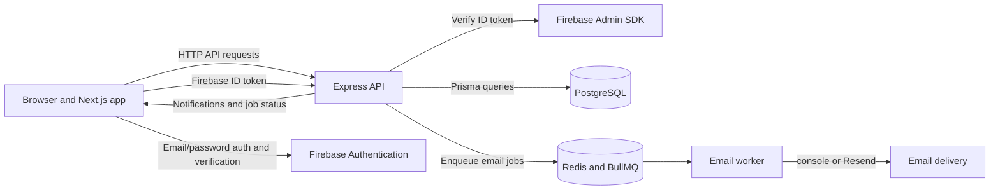

# TaskFlow

TaskFlow is a multi-tenant project and task management application. Teams organize work into organizations and projects, track tasks through a workflow, assign teammates, discuss work, and receive in-app and email notifications.

This repository contains a Next.js frontend and an Express API backed by PostgreSQL. The API uses Prisma for data access and Redis/BullMQ for asynchronous email jobs. Firebase Authentication is used by the frontend account flow; the backend also retains API-based registration and login endpoints for legacy accounts and test clients.

## What is implemented

- Firebase email/password sign-up and sign-in, Firebase email verification, and a backend Firebase ID-token exchange.
- Legacy API registration with a one-time email verification code, email/password login, refresh-token rotation, logout, and password reset.
- Multiple organizations per user, organization-scoped roles, organization switching, member management, and admin transfer.
- Organization invitations with seven-day expiry, public invitation details, accept/reject/cancel, email matching, and re-invitation after rejection.
- Projects, project dashboards, tasks, status and priority, filters, pagination, due dates, assignments, and task comments.
- Persisted user notifications, unread counts, individual mark-read and mark-all-read actions.
- BullMQ email jobs for task assignment, organization invitations, password reset, and verification messages, with retries and a dead-letter queue.
- A responsive web app with marketing, authentication, invitation, and authenticated workspace routes.

## Architecture



The backend server entry point starts the API and an email worker. A separate worker entry point is also available. The Docker Compose file defines both an API service and a worker service; because the API process also starts a worker, Compose currently runs an additional queue consumer. Confirm that this is the intended worker capacity for your environment.

## Technology

Versions below are package manifest declarations or container image tags in this repository.

| Area | Technology | Purpose |
| --- | --- | --- |
| Frontend | Next.js ^16.3.6, React ^19.3.0, TypeScript ^5.9.3 | App Router UI |
| UI and data | Tailwind CSS ^4.3.3, TanStack Query ^5.104.0, Radix UI, dnd-kit | Styling, server state, accessible controls, drag-and-drop |
| Backend | Node.js >=22, Express ^5.1.0, TypeScript ^5.9.2 | REST API and background worker |
| Database | PostgreSQL, Prisma ^6.15.0 | Relational persistence and migrations |
| Jobs | Redis, BullMQ ^5.58.1 | Asynchronous email delivery and job status |
| Authentication | Firebase JS SDK ^13.0.0, Firebase Admin ^14.5.0, JWT, bcrypt | Firebase identity verification and TaskFlow sessions |
| Email | Resend ^6.32.1 or console provider | Optional external delivery or local inspection |
| Quality | Vitest, Supertest, Playwright, ESLint | Unit, API integration, browser, and static checks |
| Local infrastructure | Docker Compose, postgres:17-alpine, redis:8.10.0-alpine | Local database and queue services |

## Repository layout

```text
.
├── README.md
├── TASKFLOW_HANDOFF.md
├── package-lock.json         Root lockfile; application manifests are below
├── taskflow-backend/
│   ├── prisma/                Schema, migrations, and seed
│   ├── .github/workflows/ci.yml
│   ├── src/
│   │   ├── auth/              Authentication endpoints and services
│   │   ├── comments/          Task comment API
│   │   ├── config/            Environment, Prisma, Redis, and logging
│   │   ├── jobs/              BullMQ queues, processors, and status API
│   │   ├── middleware/        Authentication and authorization
│   │   ├── notifications/     Persisted notification API
│   │   ├── organizations/     Organizations, members, invitations
│   │   ├── projects/          Project API
│   │   ├── tasks/             Task and assignment API
│   │   └── users/              Profile and membership API
│   ├── tests/                 Unit and integration tests
│   ├── postman/TaskFlow.postman_collection.json
│   ├── src/docs/              OpenAPI source and Swagger routes
│   ├── worker/worker.ts
│   ├── docker-compose.yml
│   └── Dockerfile
└── taskflow-frontend/
    ├── .github/workflows/frontend-ci.yml
    ├── src/app/               Marketing, auth, invitation, workspace routes
    ├── src/components/        Shared and feature UI
    ├── src/hooks/             Data hooks
    ├── src/lib/               API client, auth, navigation, utilities
    ├── tests/                 Vitest and Playwright tests
    └── .env.example
```

## How the application works

### Authentication and account security

The frontend uses Firebase email/password authentication for its primary registration and login flow. After Firebase email verification, it sends the Firebase ID token to POST /auth/firebase-exchange. The backend verifies that token with Firebase Admin, then issues TaskFlow access and refresh tokens. A new Firebase identity creates a TaskFlow user and an initial organization. An existing TaskFlow account is not silently linked to Firebase based only on matching email; the Firebase UID must already be linked.

The API also provides legacy POST /auth/register, POST /auth/verify-registration, and POST /auth/login endpoints. Legacy registration creates a pending registration and sends an application-generated six-digit OTP through the email queue. The pending user and organization are created after the code is accepted. The frontend falls back to the legacy login endpoint when Firebase reports a credential failure, supporting older TaskFlow accounts.

TaskFlow access tokens are JWTs with an active organization and role. Their default lifetime is 15 minutes. Refresh tokens are stored as SHA-256 hashes, rotate on refresh, and default to a seven-day lifetime. The frontend stores TaskFlow tokens in browser local storage and attaches the access token as a Bearer token. The API is authoritative for authentication and authorization; frontend role checks only control presentation.

Other implemented account endpoints include password reset, email verification and resend for API-managed accounts, logout, and organization selection. API-generated verification codes expire after 10 minutes, allow five failed attempts, and have a 60-second resend cooldown. The authentication router applies a limit of 10 requests per minute per IP. Password hashing requires bcrypt cost factor 12 or higher. Authenticated product routes require verified email.

### Organizations and roles

A user can have memberships in multiple organizations. OrgMember stores the role per organization; supported roles are ORG_ADMIN and MEMBER. The active organization is derived from the TaskFlow access token. Organization, project, task, assignment, comment, job, and notification operations are scoped on the server.

Admins can create invitations for an email and choose the invited role. The invitation table stores a hash of each token; the raw token is also present in invite URLs, notification links, and queued email job payloads. Treat those links and queue data as bearer credentials. Invitations expire after seven days. Existing registered invitees also receive a persisted in-app notification; email delivery is queued when a queue is available. Public lookup returns organization name, invited email, role, expiry, and invitation status. Accept and reject require an authenticated, verified user whose email matches the invitation. Conditional database updates make accept and reject mutually exclusive under concurrent requests. Processed, cancelled, and expired invitations cannot be processed again. Rejecting an invitation permits a new invitation to that email.

Admins can change member roles, remove members, transfer admin, cancel invitations, and delete an organization. Members can leave an organization; last-admin checks protect organizations with remaining members. The authenticated app refreshes its organization context after accepting an invitation.

### Projects, tasks, and comments

Projects belong to an organization. Tasks belong to projects and include title, description, status, priority, optional due date, and timestamps. Task statuses are To do, In progress, Review, and Done; priorities are Low, Medium, High, and Urgent. Task lists support project, status, priority, assignee, due-date, and overdue filtering plus pagination.

Tasks can be assigned to organization members. Assignment records are persisted before email delivery is attempted. Comments belong to a task and an author; the API allows listing and creation, author edits, and deletion by the author or an organization admin. Project deletion is admin-only.

### Notifications and email jobs

Notifications are persisted in PostgreSQL and read only within the authenticated user's scope. The API returns the user's notifications and unread count, supports marking one notification read, and supports mark-all-read. Notifications are created for task assignments, invitations to existing users, and organization deletion.

Email work is sent through the taskflow-email BullMQ queue in Redis. The worker supports task assignment, organization invitation, password reset, and email verification messages. Jobs retry up to three times with exponential backoff (one, two, then four seconds). Failed jobs remain queryable; after retries are exhausted, the worker copies failure details and payload to taskflow-email-dlq. Dead-letter entries are not retried automatically. GET /jobs/:id returns job status for an authorized organization.

The console email provider is suitable for local development: it writes the email body to process output so a developer can inspect locally generated codes and links. That output can contain verification codes, reset links, and invitation tokens; do not use the console provider where logs are accessible to untrusted users. The Resend provider requires RESEND_API_KEY and a sender address/domain verified with Resend. Provider setup alone does not guarantee delivery to arbitrary recipients; account, sender, and recipient restrictions depend on provider configuration.

## Local development

### Prerequisites

- Node.js 22 or newer and npm. The frontend declares Node.js >=20.9; Node.js 22 satisfies both applications.
- Docker Desktop with Docker Compose, or available local PostgreSQL and Redis instances.
- A Firebase project with Email/Password enabled for the frontend's Firebase sign-up and sign-in flow.
- Resend is optional for local development; the console email provider needs no external email service.

### 1. Clone the repository

PowerShell:

```powershell
git clone <repository-url> taskflow
Set-Location taskflow
```

Bash:

```bash
git clone <repository-url> taskflow
cd taskflow
```

### 2. Configure the backend

PowerShell:

```powershell
Set-Location taskflow-backend
if (-not (Test-Path .env)) { Copy-Item .env.example .env } else { Write-Output 'Existing .env left unchanged.' }
```

Bash:

```bash
cd taskflow-backend
test -e .env || cp .env.example .env
```

Edit taskflow-backend/.env with local-only values. The example is set up for a host-run backend and the Compose PostgreSQL port. Replace placeholder passwords and JWT secrets with local values. Keep EMAIL_PROVIDER=console for local development. Set FRONTEND_URL=http://localhost:3001 so invitation, password-reset, and task email links use the frontend origin.

#### Backend environment variables

| Variable | Required / default | Purpose |
| --- | --- | --- |
| DATABASE_URL | Required | Prisma PostgreSQL connection string. For host-run local development, Compose publishes the database on port 5433. |
| POSTGRES_DB, POSTGRES_USER, POSTGRES_PASSWORD | Required by backend environment validation and Compose | Local database settings; the backend currently requires these even when DATABASE_URL is supplied separately. |
| JWT_SECRET, JWT_REFRESH_SECRET | Required | Separate secrets for signing access and refresh tokens. |
| PORT | 3000 | API listen port. |
| NODE_ENV | development by default | Runtime mode: development, test, or production. |
| REDIS_URL | Optional | redis:// or rediss:// URL; when absent, the app uses REDIS_HOST and REDIS_PORT. |
| REDIS_HOST, REDIS_PORT | localhost, 6379 | Redis host/port fallback. |
| JWT_ACCESS_TTL_SECONDS | 900 | Access-token lifetime in seconds. |
| JWT_REFRESH_TTL_SECONDS | 604800 | Refresh-token lifetime in seconds. |
| BCRYPT_ROUNDS | 12 | Password-hash cost factor; values below 12 are rejected. |
| FRONTEND_URL | http://localhost:3000 in code | Frontend base URL used in email links; set explicitly for local and hosted environments. |
| EMAIL_PROVIDER | console | console for local email output or resend for external delivery. |
| RESEND_API_KEY, RESEND_FROM_ADDRESS | Required for Resend | Backend-only API key and verified sender address. |
| FIREBASE_PROJECT_ID, FIREBASE_CLIENT_EMAIL, FIREBASE_PRIVATE_KEY | Required for Firebase exchange | Firebase Admin service-account fields used to verify ID tokens. The private key is a backend secret; escaped newline sequences are converted by the code. |

The [backend .env.example](taskflow-backend/.env.example) documents core database, Redis host/port, JWT, port, frontend URL, and email provider settings. It does not include Firebase Admin or every optional variable; use the table above as the additional reference.

### 3. Start local PostgreSQL and Redis

From taskflow-backend/, start only the local services:

```powershell
docker compose up -d postgres redis
```

Compose publishes PostgreSQL at localhost:5433 and Redis at localhost:6379. Containers on the Compose network use postgres:5432 and redis:6379. Do not point test commands at a production or shared database.

### 4. Install, migrate, and seed the backend

From taskflow-backend/:

```powershell
npm install
npm run prisma:deploy
npm run prisma:generate
npm run prisma:seed
```

npm install runs Prisma Client generation as a postinstall step; the explicit generate command is useful after schema or generated-client changes. prisma:seed seeds local demonstration data. Seeded account details are public demo material; never reuse demo credentials for a real account.

### 5. Configure the frontend and Firebase

In a second terminal from the repository root:

```powershell
Set-Location taskflow-frontend
if (-not (Test-Path .env.local)) { Copy-Item .env.example .env.local } else { Write-Output 'Existing .env.local left unchanged.' }
```

The [frontend .env.example](taskflow-frontend/.env.example) provides API, demo, and worker-status variables. It does not list the Firebase web settings used by the app; add these locally as well. Set NEXT_PUBLIC_API_URL=http://localhost:3000. Create a Firebase web app and enable Email/Password sign-in in Firebase Authentication. Add localhost to Firebase Auth authorized domains if needed. Add the web app's public configuration to .env.local:

| Variable | Purpose |
| --- | --- |
| NEXT_PUBLIC_API_URL | API base URL; defaults to http://localhost:3000. |
| NEXT_PUBLIC_DEMO_MODE | Optional demo sign-in buttons. |
| NEXT_PUBLIC_DEMO_PASSWORD | Optional browser-visible password for a public demo account only. |
| NEXT_PUBLIC_WORKER_DEPLOYED | Optional UI hint about job status; it does not verify a worker is running. |

| Variable | Purpose |
| --- | --- |
| NEXT_PUBLIC_FIREBASE_API_KEY | Firebase web app API key |
| NEXT_PUBLIC_FIREBASE_AUTH_DOMAIN | Firebase Auth domain |
| NEXT_PUBLIC_FIREBASE_PROJECT_ID | Firebase project identifier; use the same project as the backend service account |
| NEXT_PUBLIC_FIREBASE_STORAGE_BUCKET | Firebase web app configuration |
| NEXT_PUBLIC_FIREBASE_MESSAGING_SENDER_ID | Firebase web app configuration |
| NEXT_PUBLIC_FIREBASE_APP_ID | Firebase web app configuration |

These Firebase web settings are intended for browser use, though API-key restrictions should still be configured in Firebase. The backend service-account private key must never use a NEXT_PUBLIC_ variable.

All NEXT_PUBLIC_ variables are embedded in frontend browser code at build time. They are public values, not secret storage. NEXT_PUBLIC_DEMO_PASSWORD is visible to anyone who can load the built app; only use it for an intentionally public demo account, and leave it unset for non-demo deployments. Do not put private account credentials, API keys, JWT secrets, database URLs, or service-account credentials in frontend variables.

### 6. Start the applications

Run the backend from taskflow-backend/:

```powershell
npm run dev
```

The API listens at http://localhost:3000. This server entry point also starts an email worker. A standalone worker entry point is available with npm run worker:dev; running it alongside the API adds another queue consumer.

Run the frontend from taskflow-frontend/:

```powershell
npm run dev -- -p 3001
```

The frontend is then available at http://localhost:3001. Next.js defaults to port 3000, which conflicts with the API, so use port 3001 when both run locally. The frontend .env.example points the API client at http://localhost:3000. Prisma Studio uses its default address http://localhost:5555.

| Service | Local address |
| --- | --- |
| Frontend | http://localhost:3001 |
| API and Swagger UI | http://localhost:3000 and /api-docs |
| PostgreSQL from the host | localhost:5433 |
| Redis from the host | localhost:6379 |
| Prisma Studio | http://localhost:5555 |

### Optional full Compose stack

The backend [Docker Compose file](taskflow-backend/docker-compose.yml) also defines api and worker services:

```powershell
Set-Location taskflow-backend
docker compose up --build
```

The Compose API and worker containers use internal PostgreSQL and Redis hostnames. The current Compose file forwards only a subset of backend environment settings; it does not pass through Firebase Admin credentials, Resend credentials, or FRONTEND_URL. The API and worker therefore use their defaults for omitted settings. Use the host-run backend workflow above when you need the sample local FRONTEND_URL or Firebase/Resend configuration, or provide an appropriate Compose override outside this repository.

## Database and migrations

The PostgreSQL schema is defined in [the Prisma schema](taskflow-backend/prisma/schema.prisma). Main relationships:

- A user has memberships in organizations through org_members; the membership stores that organization's role.
- An organization owns projects and invitations.
- Projects contain tasks; tasks have assignments and comments.
- Users own refresh tokens, password-reset tokens, email-verification codes, and notifications.
- Invitation, refresh, and password-reset tables store token hashes. Raw invitation/reset links and email codes are also present in notification records or queued email payloads so they can be delivered; protect database and Redis access accordingly.

The migration history is in [taskflow-backend/prisma/migrations](taskflow-backend/prisma/migrations/). It creates the initial work-management schema, then adds refresh tokens, password reset, invitations, notifications, email verification, pending registrations, Firebase UID linking, and invitation rejection state. The invitation rejection migration adds nullable rejectedAt to organization_invitations.

Useful commands from taskflow-backend/:

```powershell
npx prisma migrate status
npm run prisma:deploy
npm run prisma:generate
npm run prisma:seed
npx prisma studio
```

Use npm run prisma:migrate (prisma migrate dev) only for local schema development. Use npm run prisma:deploy (prisma migrate deploy) to apply already-authored migrations in a release environment. Review migration status and confirm the target database before deployment. migrate deploy applies all pending migrations; it does not generate Prisma Client or seed data. Never point development, seed, or test commands at production. Do not use migrate dev, db push, reset commands, or test suites against production.

## API overview

The API defaults to http://localhost:3000. The /health endpoint checks Redis availability and returns 200 or 503; it does not report a PostgreSQL health check. Interactive OpenAPI documentation is served at /api-docs, with its JSON document at /api-docs/openapi.json.

| Area | Routes |
| --- | --- |
| Authentication | POST /auth/register, /auth/verify-registration, /auth/resend-registration, /auth/login, /auth/firebase-exchange, /auth/refresh, /auth/logout, /auth/select-org, /auth/forgot-password, /auth/reset-password, /auth/verify-email, /auth/resend-verification |
| Users | GET /users/me, PATCH /users/me, POST /users/me/change-password, GET /users/me/organizations |
| Organizations | POST /organizations, GET /organizations/me, GET /organizations/me/members, PATCH /organizations/me/members/:userId, DELETE /organizations/me/members/:userId, POST /organizations/me/invitations, GET /organizations/me/invitations, DELETE /organizations/me/invitations/:id, POST /organizations/invitations/:token/accept and /reject, POST /organizations/invitations/accept (legacy body-token form), GET /organizations/invitations/:token, DELETE /organizations/me/membership, POST /organizations/me/transfer-admin, DELETE /organizations/me |
| Projects | GET, POST /projects; GET, PATCH, DELETE /projects/:id; GET /projects/:id/dashboard |
| Tasks | GET, POST /tasks; GET, PATCH, DELETE /tasks/:id; POST /tasks/:id/assign; DELETE /tasks/:id/assign/:userId |
| Comments | GET, POST /tasks/:taskId/comments; PATCH, DELETE /tasks/:taskId/comments/:commentId |
| Notifications | GET /notifications; PATCH /notifications/:id/read; POST /notifications/read-all |
| Job status | GET /jobs/:id |

Normal application routes require a valid TaskFlow access token and verified email. Admin-only operations are checked by the backend. Request bodies and query values are validated with Zod. See the route modules and OpenAPI document for response shapes and detailed endpoint behavior.

## Tests and quality checks

Backend Vitest tests include unit tests and HTTP integration tests using Vitest and Supertest. Integration tests use taskflow-backend/.env.test; reset helpers truncate application tables. Set this file to a dedicated local test database before running backend tests. Never use a development database with valuable data, a shared database, or production as the test database.

The provided test example points at a local database named taskflow_test. Create it once in the local Compose PostgreSQL instance if needed (adjust the local user and database names if you changed the example):

```powershell
Set-Location taskflow-backend
if (-not (Test-Path .env.test)) { Copy-Item .env.test.example .env.test } else { Write-Output 'Existing .env.test left unchanged.' }
docker compose exec postgres psql -U taskflow -d taskflow -c "CREATE DATABASE taskflow_test;"
npm run test:migrate
```

Check that .env.test points to the test database before running these commands. If the database already exists, skip the create command. Tests reset rows in the test database.

Backend commands:

```powershell
npm test
npm run test:unit
npm run test:integration
npm run test:watch
npm run test:coverage
npm run typecheck
npm run lint
npm run build
```

Frontend commands from taskflow-frontend/:

```powershell
npm test
npm run test:e2e
npm run typecheck
npm run lint
npm run build
```

Frontend Vitest tests cover utility, session, error, and navigation behavior. Playwright E2E tests use a real browser and a running frontend and backend; install the Playwright Chromium browser on the development machine as needed. The Playwright config defaults to http://localhost:3000; when the frontend runs on port 3001, set E2E_BASE_URL=http://localhost:3001 before npm run test:e2e.

PowerShell example from taskflow-frontend/:

```powershell
$env:E2E_BASE_URL = "http://localhost:3001"
npm run test:e2e
```

Recorded verification for this repository state: backend tests passed with 127 tests across 16 files and 3 todo; frontend Vitest passed with 24 tests across 4 files; both typechecks and the frontend production build passed. These are point-in-time results, not a guarantee for later changes. The frontend lint run reported two warnings and no errors.

GitHub Actions workflows are checked in at [backend CI](taskflow-backend/.github/workflows/ci.yml) and [frontend CI](taskflow-frontend/.github/workflows/frontend-ci.yml). Backend CI provisions PostgreSQL and Redis, then runs migration setup, lint, typecheck, unit/integration tests, build, and a health smoke check. Frontend CI runs lint, typecheck, Vitest, and build; its Playwright E2E job is present but disabled because it has no backend/database services. These are verification workflows, not deployment workflows.

### Troubleshooting

- If the API and Next.js both try to bind port 3000, start the frontend with port 3001 and set FRONTEND_URL to http://localhost:3001.
- The API server requires Redis at startup. Check REDIS_URL or REDIS_HOST/REDIS_PORT and confirm the local Redis service is healthy.
- Firebase sign-up requires the frontend Firebase web settings and Email/Password provider to be configured. Firebase ID-token exchange also requires the backend Firebase Admin credentials.
- Prisma commands require DATABASE_URL. Check that it points at the intended local database before applying migrations or running seed commands.
- Backend tests truncate tables in the database configured by .env.test. Confirm it is the dedicated taskflow_test database before running tests.
- With EMAIL_PROVIDER=console, inspect local backend process output for email codes and links. This provider is not suitable for production delivery.

## Deployment

The repository includes a backend Dockerfile, a local Docker Compose file, and a frontend suitable for a Next.js host. It does not include Vercel, Render, or Supabase deployment manifests, checked-in hosting secrets, or a CI release workflow. The frontend example and OpenAPI document reference a Render API address, but this review did not verify live hosting configuration or deployment state.

A deployment using Vercel for the frontend, Render for the API/worker, and Supabase for PostgreSQL should configure these settings in the appropriate provider dashboards:

1. **Database:** Create the PostgreSQL database and provide its connection string as backend DATABASE_URL. The application also currently requires non-empty POSTGRES_DB, POSTGRES_USER, and POSTGRES_PASSWORD variables at startup. Use the database provider's documented connection mode for the long-lived backend and migration runner.
2. **Redis:** Provide a reachable Redis service. Set REDIS_URL (use rediss:// when the provider requires TLS) or set REDIS_HOST and REDIS_PORT.
3. **Backend:** Build/deploy from taskflow-backend/ using the Dockerfile or Node scripts. The runtime entry point is npm start / node dist/src/server.js; a standalone worker entry point is available as npm run worker. Configure separate strong JWT_SECRET and JWT_REFRESH_SECRET, Firebase Admin credentials if using Firebase exchange, FRONTEND_URL, and email-provider settings. Set PORT according to the host's assigned port.
4. **Migrations:** Include all migration files in the release artifact. Before the new application version serves traffic, inspect npx prisma migrate status and run npm run prisma:deploy in the backend release environment with the intended production database URL. Review all pending migrations first; this command applies every pending migration.
5. **Frontend:** Deploy taskflow-frontend/ as a Next.js application. Set NEXT_PUBLIC_API_URL to the backend's public base URL and supply Firebase web configuration. These variables are compiled into the browser bundle at build time. Ensure backend FRONTEND_URL points to the frontend origin used in invitation and password-reset links.
6. **Email:** Set EMAIL_PROVIDER=resend, RESEND_API_KEY, and RESEND_FROM_ADDRESS only when the Resend sender is configured and verified. Confirm delivery in the provider's own logs. Do not assume a test sender can send to arbitrary addresses.
7. **CORS and health:** The API currently uses default cors() middleware without a configured origin allowlist. /health checks Redis only. These behaviors are in application code, not platform settings.

Vercel, Render, and Supabase are deployment options and references in project documentation, not a claim that their dashboards are currently configured. Never use production as the test database. Run migrations through a controlled release step, not through prisma migrate dev, db push, a seed command, or application tests.

## Security notes and operational limits

- NEXT_PUBLIC_ values are public in the browser bundle. Never put backend secrets in them. The optional demo-password variable is public too and must only relate to a deliberately public demo account.
- Firebase Admin private-key material, JWT secrets, database passwords, Redis credentials, and Resend API keys belong in backend environment variables or a hosting secret store. Do not commit .env, service-account JSON, private keys, or production URLs containing credentials.
- The root .gitignore excludes .env files and generated outputs. Before submitting work, check git status --short and git check-ignore taskflow-backend/.env taskflow-backend/.env.test taskflow-frontend/.env.local. Keep example files placeholder-only.
- The browser stores TaskFlow tokens in local storage. Keep frontend dependencies current and avoid injecting untrusted HTML; the API remains responsible for enforcing access.
- The API currently enables CORS without an origin allowlist. Restricting browser origins requires an application/configuration change; no CORS environment variable is implemented.
- The console email provider logs message bodies, which can include one-time codes and bearer-style links. Use it only with local, access-controlled logs.
- The raw invitation token is included in a registered invitee's persisted notification link and in queued email payloads. Access to notification rows, Redis, and worker logs therefore needs to be restricted; notification API responses themselves are user-scoped.
- A seeded/demo password is present in repository demo material. Treat demo accounts as public, do not reuse that credential, and rotate/disable the corresponding accounts if used in a live environment. This README intentionally does not repeat it.
- Firebase web configuration is browser-visible by design; restrict its API key and Firebase Auth settings as appropriate. Firebase Admin service-account credentials are private.
- Delivery depends on Redis availability, worker capacity, provider configuration, and sender verification. A queued job is not proof that an email reached its recipient.
- The Docker Compose configuration does not forward all optional backend settings, and it runs a separate worker in addition to the worker started by the API process. Review these details before using the full Compose stack as a production template.

## Project summary

TaskFlow demonstrates a multi-tenant work-management system with organization-scoped authorization, relational modeling, Firebase identity verification, rotating TaskFlow sessions, invitations, and asynchronous email processing. It includes an Express/Prisma API, Next.js workspace, PostgreSQL migrations, Redis/BullMQ processing, notification ownership checks, and automated unit, integration, and browser tests. Its recorded verification counts are listed above; no traffic, latency, or capacity claims are made.

## Contributing

Keep changes focused and documented. For backend changes, use the dedicated local test database and run the relevant unit/integration tests, typecheck, and lint. For frontend changes, run Vitest, typecheck, lint, and a production build; use Playwright when a change affects browser flows. Include a Prisma migration with schema changes and review migration status before deployment. Never commit environment files, credentials, or generated build artifacts.
